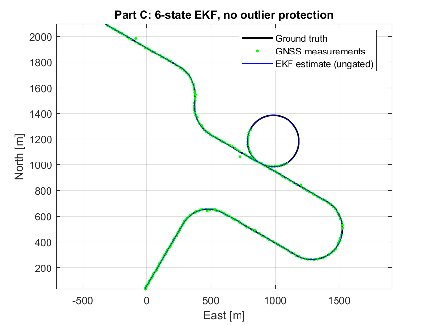
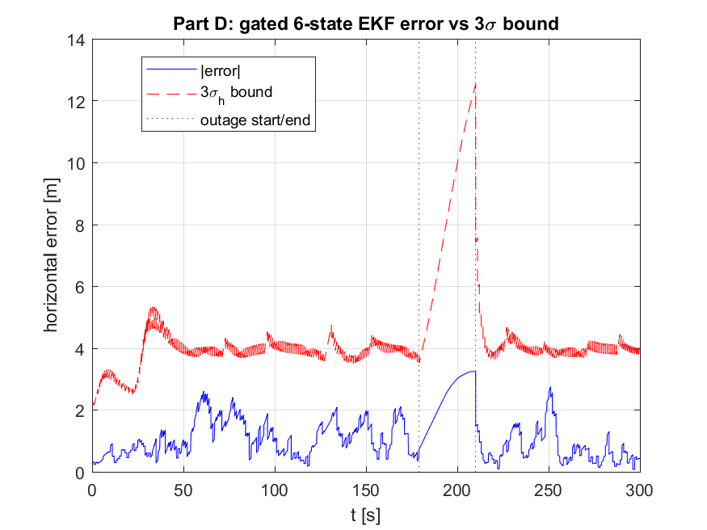
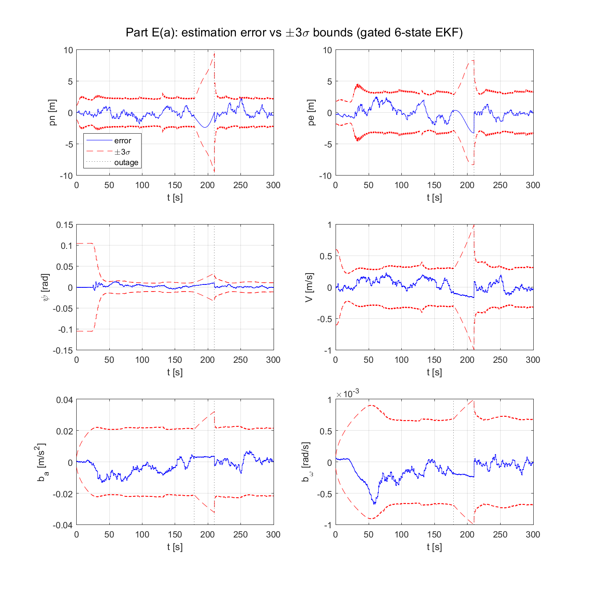
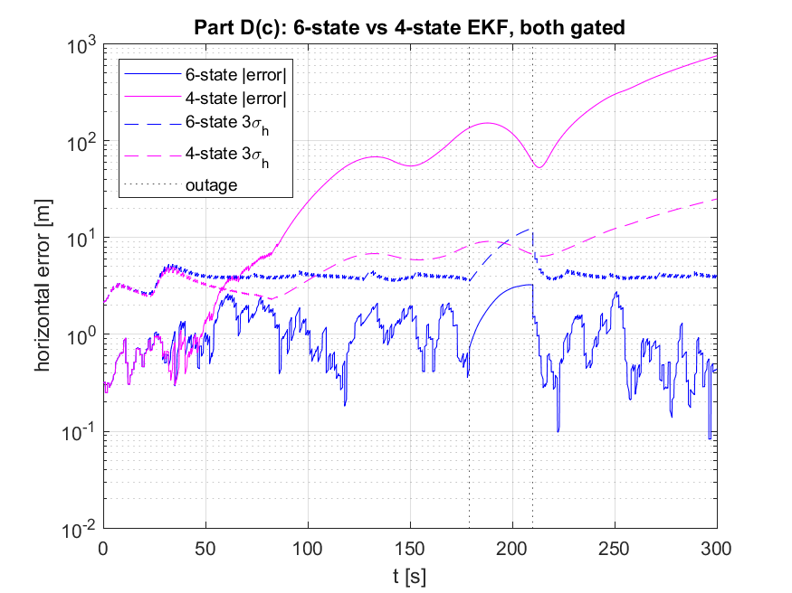

# EKF navigation with IMU and GNSS

Course project in guidance and navigation, October 2026. Written in MATLAB.

A vehicle moves in the plane (Dubins model). A 100 Hz IMU gives forward acceleration and yaw rate. A GNSS receiver gives north and east position at about 1 Hz, on a clock that is not aligned with the IMU samples. The record contains a 31 s GNSS outage and 10 multipath outliers. The goal is to estimate position, heading, speed and the two IMU biases.

*The 300 s trajectory with GNSS fixes and the 6-state EKF estimate (no outlier gate yet). The few green points off the path are multipath outliers.*

## What the code does

- Part A checks the sampling rates and the GNSS-to-IMU time offset, finds the outage, and estimates sensor noise and IMU biases from the first 20 s, when the vehicle is stationary.
- Part B runs dead reckoning from the IMU alone, with raw and bias-corrected inputs.
- Part C is a multi-rate extended Kalman filter with state `[pn, pe, psi, V, b_a, b_w]`. It predicts at every IMU sample and updates when a GNSS fix arrives, using the Joseph-form covariance update.
- Part D adds a chi-square Mahalanobis gate (p = 0.99, 2 degrees of freedom), looks at the filter through the outage, and compares it with a 4-state filter whose biases stay fixed at the Part A values.
- Part E tests consistency with NEES and NIS and sweeps the process noise Q (0.01x, 1x, 100x).
- Part G has extra runs used to choose R, the gate level and the bias random-walk level.
- Part F prints the results table.

Ground truth in the data file is used for evaluation and plots only. The filter never sees it.

## Results

Final filter: 6 states, gated.

| Quantity | Value |
|---|---|
| Horizontal RMSE, t >= 20 s | 1.382 m |
| Same metric, calibrated dead reckoning | 249 m |
| Max horizontal error during the 31 s outage | 3.248 m |
| Max error during the outage, 4-state filter | 27.035 m ungated, 152.063 m gated |
| Rejected GNSS epochs | 10 of 270 (10 true outliers, 0 false alarms) |
| Mean NIS, 2 DOF (GNSS north/east), expected 2 | 1.378 |
| Mean NEES, 6 DOF (full state), expected 6 | 2.998 |
| Final accelerometer bias (truth) | 0.10023 (0.09989) m/s^2 |
| Final gyro bias (truth) | 0.004487 (0.004492) rad/s |

Both consistency statistics sit below their expected values, so the filter is conservative: R was set larger than the static noise estimate (1.756 / 2.769 m used, 1.202 / 1.896 m measured). NEES is averaged over time in a single run (t >= 20 s); NIS uses the accepted GNSS epochs only.

*Horizontal error of the final filter. During the outage (dotted lines, 179 to 210 s) the error grows to 3.25 m while the 3-sigma bound opens to about 12.5 m, then both drop at the first fix after the outage.*

*Error of each state against its ±3σ bound from the filter covariance.*

The gated 4-state filter fails: it rejects 187 of the 270 fixes, 184 of them in a row, and ends 752.7 m off, close to dead reckoning. A fixed bias goes stale during the flight, the gate then closes, and the filter cannot recover. Estimating the biases in the state avoids this.

*6-state and 4-state filters with the same gate, log scale. The 4-state error leaves its own 3-sigma bound after about 60 s and never comes back.*

## Files

| File | Purpose |
|---|---|
| `main_p1.m` | Entry point; loads the data and runs every part in order |
| `ekf6_run.m` | 6-state multi-rate EKF with optional gate |
| `ekf4_run.m` | 4-state EKF with fixed bias correction |
| `part_A_*.m` ... `part_G_*.m` | One script per part of the assignment |
| `save_fig.m`, `wrap_angle.m` | Helpers |
| `figures/` | Plots from the code, as used in the course report |

## Running

The data file came with the course and is not in this repository. Save it as `navigation_data.mat` next to `main_p1.m` and run `main_p1.m` in MATLAB. Figures are saved as PNG through `save_fig.m`.

## AI use

Claude (Anthropic) wrote the MATLAB implementation from my instructions and corrected my errors. It also explained chi-square confidence intervals and the NEES/NIS tests. All numbers above come from running this code on the course data.
